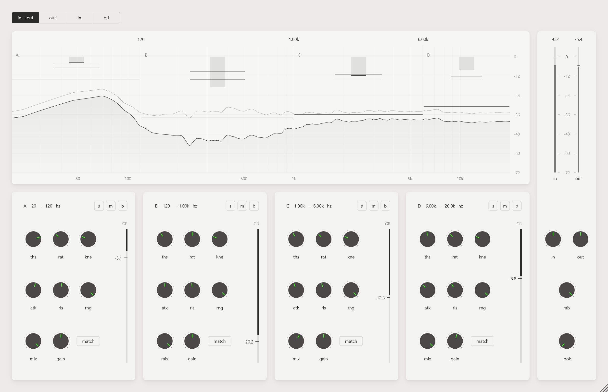

# MBC4 1.0.0

4-band multiband compressor. VST3 / AU / Standalone — Windows, macOS (Universal: Apple Silicon + Intel).



## インストール

| | Windows | macOS |
|---|---|---|
| VST3 | `C:\Program Files\Common Files\VST3\` | `~/Library/Audio/Plug-Ins/VST3/` |
| AU | — | `~/Library/Audio/Plug-Ins/Components/` |

macOS 版は Apple の署名・公証なし。コピー後に一度だけ:

```
xattr -dr com.apple.quarantine ~/Library/Audio/Plug-Ins/VST3/MBC4.vst3 ~/Library/Audio/Plug-Ins/Components/MBC4.component
killall -9 AudioComponentRegistrar
```

## 機能

- 4 バンド（A〜D）。クロスオーバーは Linkwitz-Riley 24 dB/oct ×3 + オールパス補正で、合成は振幅フラット
- 各バンド: threshold / ratio / knee / attack / release / range / mix / gain、solo / mute / bypass
- ゲインマッチ（match）: 3 秒間（無音を除く）の実効 GR を平均し、補正量を gain に一度だけ書き込む（以後は固定）
- 全体: input / output / mix、lookahead 0〜10 ms（遅延はホストに通知、バイパス時も時間整列）
- スペクトラム（in / out、1/6 オクターブ平滑化）、バンドごとの GR メーター（ホールド値表示）、IN/OUT メーター
- UI は 75〜200% で拡大縮小（サイズは保存）
- CPU: ステレオ 48 kHz で 1 コアの約 1 %

## 操作

| グラフ | |
|---|---|
| 縦線ドラッグ | クロスオーバー（Alt+クリックで初期値） |
| 周波数タグをダブルクリック | クロスオーバーを数値入力（`1.2k` / `850` など） |
| バンド内ドラッグ | スレッショルド（Ctrl / Shift: 1/6 の微調整） |
| ダブルクリック | スレッショルドを初期値に |

ノブ: ドラッグで 12 段階、Ctrl / Shift + ドラッグで連続（1/6 の速さ）、マウスオーバーで数値表示、ダブルクリックで直接入力、Alt+クリックで初期値。
バンド見出しの周波数（例: `120 - 1.00k hz`）もダブルクリックで直接入力できます。

略称: ths = threshold / rat = ratio / kne = knee / atk = attack / rls = release / rng = range / look = lookahead

## 信号処理

```
入力 → input → 帯域分割 → [バンドごと] 検出 → ゲイン計算 → lookahead → attack/release → mix → gain → solo/mute
                                                                                     → 合算 → output → 出力
```

- 検出: ステレオリンクの瞬時ピーク `L = 10·log10(max(xL², xR²))`
- ゲイン計算: 2 次ソフトニー、`(1/R − 1)·超過量`、range で上限
- lookahead: 先 N サンプル内の最大圧縮量（スライディング最大値）、音声は N サンプル遅延
- 平滑化: smooth decoupled peak detector（リリースでホールド → アタックで平滑）
- 出力: `((1 − mix) + mix·10^(−GR/20)) · 10^(gain/20)`（位相ずれのないパラレル）

## ビルド

**Windows**（VS 2026 Build Tools + CMake）

```
powershell -ExecutionPolicy Bypass -File build.ps1            # Release
powershell -ExecutionPolicy Bypass -File build.ps1 -Install   # + VST3 フォルダへコピー
```

パスに日本語が含まれると JUCE の juceaide が落ちるため、`build.ps1` は親フォルダを `M:` に `subst` してビルドします。

**macOS**（Xcode command line tools + CMake）

```
./build_mac.sh --install
```

JUCE は `../Plugin/JUCE` があればそれを、無ければ 8.0.12 を自動取得します。
`main` へ push すると GitHub Actions が macOS / Windows をビルド・テストし、成果物を Artifacts に置きます。

## テスト

```
cmake --build <build> --config Release --target MBC4_Tests
<build>/Release/MBC4_Tests [snapshot.png] [scale]
```

クロスオーバーの平坦性、圧縮量、mix、ゲインマッチ、lookahead（遅延量・トランジェント）、CPU、UI スケール保存を確認し、引数があれば UI のスナップショットを書き出します。
