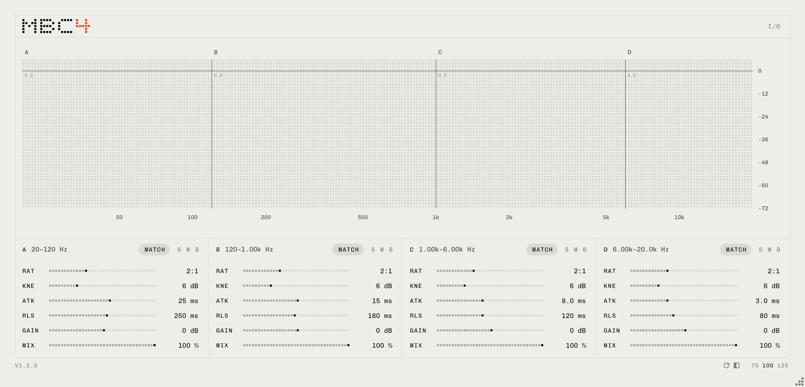

# MBC4 1.2.0

4-band multiband compressor. Rust + [truce](https://truce.audio/)。VST3 / CLAP / Standalone（Windows）、VST3 / CLAP / AU（macOS）。



1.2.0 で UI を共通のデザインコンセプト（[`../DESIGN_CONCEPT.md`](../DESIGN_CONCEPT.md)）に合わせて組み直しました: 100 % = 1080 × 520。INPUT / OUTPUT（入出力ゲイン、メーター、lookahead、全体の mix）は上段右端の I/O ボタンで右側に開き（ウィンドウが 130 px 広がる）、初期状態は格納（開閉はプロジェクトに保存）。IN / OUT のゲインはメーターに重ねたつまみ（メーター上を上下ドラッグ）。各バンドの GR はグラフのスレッショルド線の左端の下に、太さ 1.5 の線と小さな数値で表示（後ろは数値の文字の高さぶんだけ背景色で抜く）（60 Hz で毎回更新、数値はバーの先端に付いて動く）。バンドのつまみはすべて横スライダー（threshold はグラフで操作）、range は廃止。ライト / ダークのテーマ、フッターに Reset・テーマ切替・UI サイズ、Undo / Redo（Ctrl+Z / Ctrl+Shift+Z・Ctrl+Y）。表示は 60 Hz で更新。

2.0.0 でフレームワークを JUCE から truce に移しました。信号処理（Linkwitz-Riley の TPT 実装、ゲイン計算、lookahead、平滑化）と UI のレイアウト・操作は 1.1.0 と同じです。
プラグイン ID が変わるため、1.x を使ったプロジェクトでは MBC4 を挿し直す必要があります（設定は引き継がれません）。

## インストール

| | Windows | macOS |
|---|---|---|
| VST3 | `C:\Program Files\Common Files\VST3\` | `~/Library/Audio/Plug-Ins/VST3/` |
| CLAP | `C:\Program Files\Common Files\CLAP\` | `~/Library/Audio/Plug-Ins/CLAP/` |
| AU | — | `~/Library/Audio/Plug-Ins/Components/` |

macOS 版は Apple の署名・公証なし。コピー後に一度だけ:

```
xattr -dr com.apple.quarantine ~/Library/Audio/Plug-Ins/VST3/MBC4.vst3 ~/Library/Audio/Plug-Ins/Components/MBC4.component
killall -9 AudioComponentRegistrar
```

## 機能

- 4 バンド（A〜D）。クロスオーバーは Linkwitz-Riley 24 dB/oct ×3 + オールパス補正で、合成は振幅フラット
- 各バンド: threshold / ratio / knee / attack / release / gain / mix、solo / mute / bypass
- ゲインマッチ（match）: 3 秒間（無音を除く）の実効 GR を平均し、補正量を gain に一度だけ書き込む（以後は固定）
- 全体: input / output（±36 dB）/ mix、lookahead 0〜10 ms（遅延はホストに通知、DAW のバイパス時も時間整列）
- スペクトラム（常に in と out を重ねて表示、1/6 オクターブ平滑化。mix が 100 % 未満のとき、削られた量のオレンジは先端から根元へ薄くなる）、バンドごとの GR（スレッショルド線の下、60 Hz で更新）、IN/OUT メーター
- UI は 75〜125 % で拡大縮小（フッターの 75 / 100 / 125、または右下の角をドラッグ。初期 100 %、サイズは保存）。テーマ（ライト / ダーク）は PC1 系プラグイン共通の設定（`%APPDATA%\PC1-style\settings.cfg`）。フォントは Inter Display 4.1（Regular / Light / ロゴは Bold、SIL OFL 1.1、`resources/fonts/Inter-OFL.txt`）
- CPU: ステレオ 48 kHz で 1 コアの約 1 %

## 操作

| グラフ | |
|---|---|
| 縦線ドラッグ | クロスオーバー（Shift / Ctrl: 細かく） |
| バンド内ドラッグ | スレッショルド、1 dB 刻み（Shift / Ctrl: 0.1 dB） |
| ダブルクリック / Alt+クリック | クロスオーバー / スレッショルドを初期値に |

フェーダー / スライダー: ドラッグとホイールは決まった刻みで止まる（Shift / Ctrl で細かく）、ダブルクリックまたは Alt+クリックで初期値、値の文字をダブルクリックで直接入力（Enter か外をクリックで確定、Esc で取り消し）。
Ctrl+Z / Ctrl+Shift+Z（Ctrl+Y）で元に戻す / やり直す（1 回のドラッグやホイール操作が 1 ステップ）。フッターの Reset はすべてを初期値に戻します（Ctrl+Z で戻せます）。0.5 秒ホバーでツールチップ。
バンド見出しの周波数（例: `120–1.00k Hz`）もダブルクリックで直接入力できます（`1.2k` / `850` など）。

略称: THS = threshold / RAT = ratio / KNE = knee / ATK = attack / RLS = release / LOOK = lookahead

## 信号処理

```
入力 → input → 帯域分割 → [バンドごと] 検出 → ゲイン計算 → lookahead → attack/release → mix → gain → solo/mute
                                                                                     → 合算 → output → 出力
```

- 検出: ステレオリンクの瞬時ピーク `L = 10·log10(max(xL², xR²))`
- ゲイン計算: 2 次ソフトニー、`(1/R − 1)·超過量`
- lookahead: 先 N サンプル内の最大圧縮量（スライディング最大値）、音声は N サンプル遅延
- 平滑化: smooth decoupled peak detector（リリースでホールド → アタックで平滑）
- 出力: `((1 − mix) + mix·10^(−GR/20)) · 10^(gain/20)`（位相ずれのないパラレル）

## ビルド

必要なもの: Rust（stable）と cargo-truce 6.3（`cargo install cargo-truce`）。macOS は Xcode command line tools も。

```bash
cargo truce build --vst3 --clap
```

```bash
cargo truce install --vst3
```

```bash
cargo truce run
```

成果物は `target/bundles/`。macOS の AU は `cargo truce build --au2`。
`main` へ push すると GitHub Actions が macOS / Windows をビルド・テストし、成果物を Artifacts に置きます。

## テスト

```bash
cargo test --release --lib
```

クロスオーバーの平坦性、圧縮量、mix、ゲインマッチ、lookahead（遅延量・トランジェント）、ホストバイパス、CPU、truce の適合チェック（状態の保存・復元、オーディオスレッドでのメモリ確保なし）と UI（描画、ツールチップ、グラフのドラッグ）を確認します。

```bash
cargo truce screenshot --out screenshots/MBC4.png
```

## ファイル

- `src/dsp.rs` 信号処理（帯域分割、バンドごとのコンプ、IN / OUT、ホストバイパス）
- `src/shared.rs` オーディオスレッド ↔ エディターの受け渡し（アナライザー、メーター、ゲインマッチ。ロックフリー）
- `src/ui.rs` エディター（egui に直接描画）
- `src/lib.rs` パラメーターとプラグイン本体、`src/tests.rs` テスト
- `vendor/truce-egui` truce-egui 6.3.0 にパッチ 2 点（マウスカーソルの反映 / キーボードフォーカスは文字入力中だけ取る。MSP1 と同じ）
